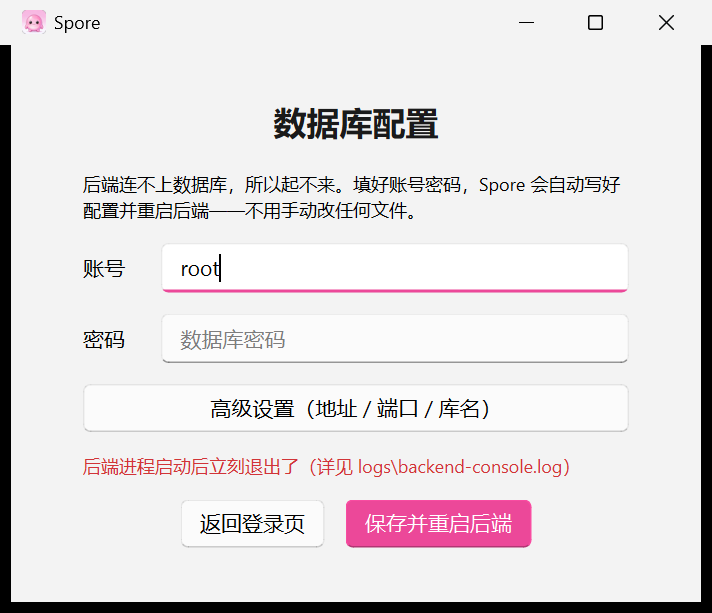
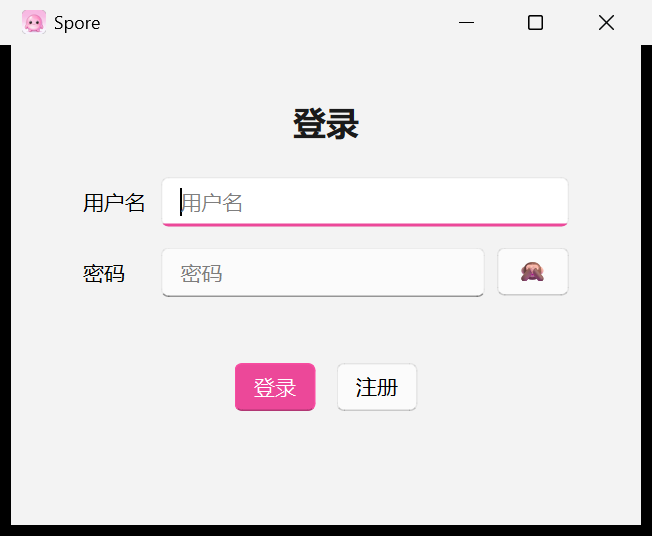

# Spore

截图搜题桌面应用：框选题目 → 大模型读题作答 → 自动联网核实 → 全程留档，可继续追问。

## 组成

| 部分 | 技术 | 说明 |
| --- | --- | --- |
| 后端 `src/` | Spring Boot + MyBatis-Plus + MySQL | 本机 8080 提供 REST 接口、题图存储、账号与同步 |
| 客户端 `client/` | Python 3.13 + PySide6（Fluent Widgets） | 截图作答、搜题记录、设置、帮助 |

## 部署（从 Release 安装）

到 [Releases](https://github.com/Offblink/Spore-GUI/releases) 下载 **`Spore-<版本>-win64.zip`（一体化包）**，
内含客户端目录（`Spore.exe` + `_internal\` 依赖）、后端 jar、`schema.sql`（建库脚本）与
`application-local.yml.example`（数据库口令模板）。首次装机按下四步走，**只需做一次**。

### 第 0 步 · 装前提

| 依赖 | 版本 | 说明 |
| --- | --- | --- |
| **JDK** | 8 | 后端是 Spring Boot 5 + Servlet 4（`javax`），必须 JDK 8 |
| **MySQL** | 5.7+ / 8.x | 存账号、搜题记录、题图索引；装完记得让它开机自启 |

> 没装 JDK 或 MySQL 也能先把窗口打开看说明——客户端起不来后端时**不弹红叉、不退出**，
> 会把原因写进界面（详见下方「启动失败怎么办」）。

### 第 1 步 · 下载解压

把 zip **整个解压到一个固定目录**，例如 `C:\Spore\`。目录里应该有：

```
Spore-<版本>-win64\
├─ Spore.exe                    ← 客户端
├─ _internal\                   ← 客户端依赖（PySide6 等）
├─ spore-backend-<版本>.jar      ← 后端
├─ schema.sql                   ← 建库脚本
├─ application-local.yml.example ← 数据库口令模板
└─ README.txt
```

> **别把 `Spore.exe` 单独挪出文件夹**：客户端按 exe 所在目录找后端 jar，依赖也从 `_internal\` 加载。
> 要挪就整个文件夹一起搬。装进 `C:\Program Files\` 也没问题（不可写时数据自动落到 `%LOCALAPPDATA%\Spore\`）。

### 第 2 步 · 准备数据库

`schema.sql` 自带 `CREATE DATABASE spore_cms` 和 `USE`，直接导入即可（**别在命令里带库名**，
否则会导到别的库）：

```bash
mysql -u root -p < schema.sql
```

它会建库并建出 7 张表：`user` `role` `permission` `category` `article` `sys_config`（外加操作日志表 `op_log`）。
账号与初始数据都由应用产生——**首个注册的用户自动成为管理员**（见第 4 步）。

> ⚠️ `schema.sql` 是「先 `DROP TABLE` 再 `CREATE`」的建库脚本，**重跑会清空该库里所有数据**。
> 只在**全新装机**时跑一次；日常升级版本**不要**重跑它，直接换 `Spore.exe` 那套文件即可。
> 真要重建库请先确认数据可以丢。

### 第 3 步 · 启动并配置数据库

双击 `Spore.exe`——后端由客户端自己拉起（**不弹命令行窗口**），关客户端即停后端。

- **v1.3.3 及以后**：如果客户端发现连不上数据库（后端起不来），会**自动弹出「数据库配置」页**，
  默认只需填**账号 + 密码**，点「保存并重启后端」——Spore 会自己写好配置并重启后端，
  **全程不用手动改任何配置文件**。地址 / 端口 / 库名已按本应用的默认值
  （`localhost:3306/spore_cms`）预填，收在「高级设置」里，只有改过端口或库名的装机才需要点开。
  填对了就直接进登录页；填错了页面会提示「数据库仍然连不上」，改完再存一次即可。

  

  > 也可以提前手动配好：复制 `application-local.yml.example` 为 `application-local.yml`，
  > 填入 MySQL 账号口令，双击 `Spore.exe` 就会直接进登录页。口令只留在你本机这个文件里，
  > **不进 git、不随包分发**。

- **v1.3.1 及以前**：必须手动复制 `application-local.yml.example` 为 `application-local.yml`
  并填好口令，否则后端起不来（只会显示一句模糊的启动失败提示）。

### 第 4 步 · 登录 / 注册

首次使用点「注册」创建账号——**第一个注册的用户自动成为管理员**，之后用「登录」进入主界面。



进入主界面后，打开「设置」页粘贴大模型 API Key（回车保存），点「测试连接」确认能通，即可开始截图搜题。

### 启动失败怎么办

客户端起不来后端时不会直接退出，会把原因显示在界面上。常见三种：

| 界面提示 | 原因 | 处置 |
| --- | --- | --- |
| 弹出「数据库配置」页 | 连不上 MySQL（口令错 / MySQL 没起 / 库名不对） | 在页里改对连接信息并保存；或确认 MySQL 服务已启动 |
| 缺 jar 提示 | `Spore.exe` 不在 jar 同目录 | 把整个解压目录放一起，别单独挪 exe |
| 缺 Java 提示 | 没装 JDK 8 | 装 JDK 8，或把 `java` 加进 `PATH` |

详细堆栈都在 `logs\backend-console.log`（与 `Spore.exe` 同目录，装进 Program Files 时在 `%LOCALAPPDATA%\Spore\logs\`）。

## 快速开始

1. 准备环境：JDK 8、Maven、Python 3.13（本机已装好即可）。
2. 构建后端 jar：`mvn clean package -DskipTests`（客户端要从 `target/` 拿 jar 起后端）。
3. 双击仓库根目录的 `start-spore.bat` 拉起客户端——**后端由客户端自己起，不弹命令行窗口**，
   退出客户端即停后端；你先自己跑了 `mvn spring-boot:run` 的话，它检测到 8080 在监听就直接复用。
4. 首次使用：打开客户端「设置」页，粘贴大模型 API Key（回车保存），点「测试连接」确认能通。

### 从源码构建客户端 exe

```bash
# 1) 干净构建 venv（别用开发 venv：它会带进全局 PyQt5 / torch）
python -m venv --without-pip client/.venv-build
python -m pip --python client/.venv-build/Scripts/python.exe install \
  "PySide6==6.10.2" "PySide6-Fluent-Widgets==1.11.3" \
  pyinstaller httpx markdown qrcode Pillow keyboard
# 2) 构建 + 自检（图标、产物、窗口存活、sha256）
python client/tools/build_exe.py
```

产物 `client/dist/Spore/`（onedir 目录：`Spore.exe` + `_internal\`，不再产单文件 exe）；打包配方在 `client/Spore.spec`。

## 功能

- **截图作答**：Alt+S 框选题目，两阶段作答（初答 → 联网核实），检索过程以小票展示
- **回答与记录吃完整 markdown**：标题、表格（带网格线、宽表自动撑满气泡）、列表、引用、
  代码块、公式渲成图（离线 mathtext，渲染失败退回源码不丢内容）
- **AI 建议框**：设置页可开启（默认关），截图后本机离线识别、自动预选题目区域——
  **拖四个边界（含角）微调、点右下角「采纳」提交**；识别不了或超时就照常手动拖框（不弹提示）
- **搜题记录**：按科目归类、收藏、重命名、移入科目、删除（连带删除题图）；标题即时检索
- **继续追问**：在记录页或回答浮窗里接着聊，回答落回同一会话
- **手动核实**：关掉自动核实后，点「核实一下」再联网核实
- **手机扫码配对**：点主界面左下角头像出二维码，手机扫码接入
  （二维码里是电脑的**局域网 IP**；手机需与电脑同一网络，首次连接被防火墙拦就放行 8080）
- **题库目录可切换**：题图随目录整体迁移（设置页）

## 快捷键

| 按键 | 作用 |
| --- | --- |
| `Alt+S` | 截图并可框选，发起一题 |
| `Alt+Z` | 呼出 / 收起回答浮窗 |

## 配置与数据

- 设置与日志：`%LOCALAPPDATA%\Spore\`
  - `ui_settings.json`：模型、核实、检索等设置，**内含 API Key，请勿外传**
  - `logs\`：运行日志；`captures\`：截图缓存
- 题图：后端「题库目录」（默认 `data/attachments`，设置页可切换）
- 数据库口令：写在 `src/main/resources/application-local.yml`（不进 git）

## 目录结构

```
spore-gui/
├─ src/main/java/…       后端（REST / 存储 / 同步 / 账号）
├─ client/spore_client/  客户端（answer 引擎、records 记录页、settings 设置、help_page 帮助）
├─ client/tests/         客户端测试
├─ start-spore.bat       一键启动客户端（后端随客户端自动起停）
└─ pom.xml
```

## 许可

课程设计项目，仅供学习使用。
